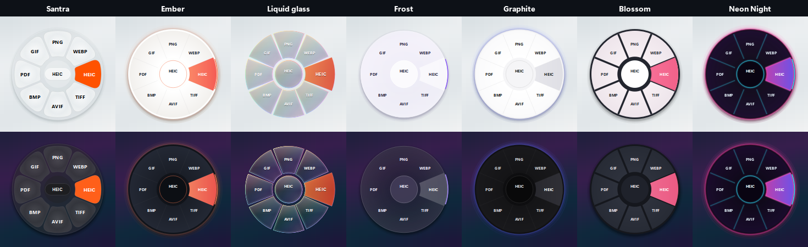
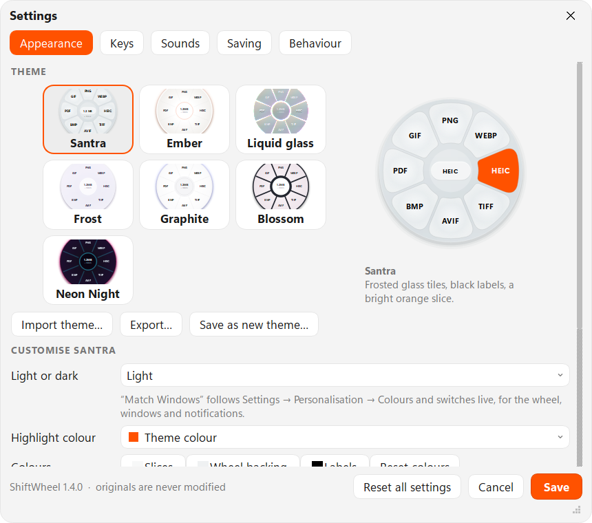
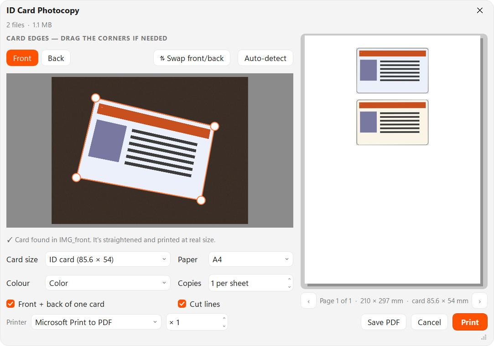
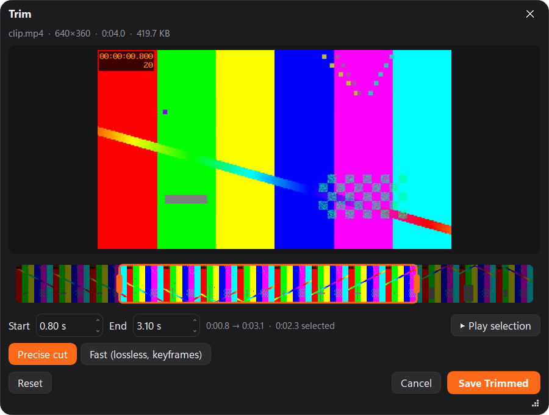

# ShiftWheel

[](https://github.com/Aditya-Prakash-047/ShiftWheel-releases/releases/latest)


Start dragging any file in File Explorer or Finder, tap a key, and drop it on a slice of the wheel. Convert it, edit it, print it or act on it, right where you are. Everything happens on your computer; nothing is uploaded.

**[Download](https://github.com/Aditya-Prakash-047/ShiftWheel-releases/releases/latest)** · [Install](#install) · [Changelog](CHANGELOG.md) · [Report a problem](https://github.com/Aditya-Prakash-047/ShiftWheel-releases/issues)



## How to use

1. Start dragging a file (or several, or a folder) in File Explorer or on the desktop.
2. While dragging, tap a key — like Santra: **Shift** converts, **Ctrl** opens tools, **Alt** opens file actions. The wheel opens under the cursor; release the key and keep dragging.
3. Drop the file on a slice. The result is saved **next to the original**; the original is never changed.
4. Tap another key to switch wheels, or the same key again to go round them: **Convert → Tools → Print → Actions**.

No dragging needed: select a file and press **Ctrl + Alt + W** — the wheel opens at the mouse. In the wheel, **arrow keys** choose, **Enter** applies, **1–9** pick a slice, **Tab** switches wheel, **Esc** cancels. Also: right-click any file → **ShiftWheel…**, **Send to → ShiftWheel**, or double-click the tray icon.

The order matters: **drag first, then the key**. Shift then drag still selects files as usual, and by default the wheel works only in file managers, so Chrome, games and other apps are left alone (Settings → Behaviour).

Every action ends with a notification showing what changed, with **Open**, **Show in folder** and **Undo**, and a soft tick plays as slices light up (Santra's sound, recreated).

## Themes

Pick one in **Settings → Appearance**. Each theme styles the wheel **and** every window, notification and menu (design tokens), and has a light and a dark version.

| Theme | Look | Inspired by |
|---|---|---|
| **Santra** (default) | Frosted glossy tiles with constant gaps and rounded corners, black labels, a solid `#FF5200` slice, a small frosted capsule in the middle. Geometry, colours and label sizes measured from the reference design | Santra |
| **Ember** | Matte charcoal or porcelain disc, hairline dividers, one coral slice and a coral marker on the rim | ShiftWheel's own design |
| **Liquid glass** | Clear glass that refracts whatever is behind it | DragShift (the original look) |
| **Frost** | Milky frosted glass with a large quiet hub | Apple's “Release to Select” menu |
| **Graphite** | Near-black disc, hairlines, faint blue halo | Radial for macOS |
| **Blossom** | Soft tiles split by bold dividers, pink highlight | FileFlow concept |
| **Neon Night** | Synthwave: glowing cyan lines, magenta highlight (dark only) | OG Converter |

**Customise any theme** (Settings → Appearance → *Customise …*): light / dark / **match Windows** (switches live) · highlight colour: the theme's, your **Windows accent colour**, presets or any colour · slice, backing and label colours · **shape**: circle, squircle, rounded square, hexagon, octagon · corner roundness, gap between slices, ring thickness, lift on hover · wheel size. Then **Save as new theme**, **Export** it, or **Reset this theme**.

### Theme files

**Import theme…** takes a `.swtheme` package (a zip with `theme.json` and optional `sounds/*.wav`) or a plain `.json` file; **Export…** writes a `.swtheme` with your colours, shape and custom sounds. Everything not given is inherited from `base`; unknown keys and bad values are ignored with a note, never a crash.

```json
{
  "format": "shiftwheel-theme", "version": 1,
  "name": "Square Mint", "author": "you", "base": "ember",
  "shape": { "outline": "square", "corner": 14, "gap": 4, "innerRatio": 0.42, "iconSet": "fluent" },
  "light": { "wheel": { "hoverOuter": "#10B981", "sliceInner": "#FFFFFF", "sliceOuter": "#ECFDF5" },
             "ui":    { "accent": "#10B981", "window": "#F6FBF8" } },
  "dark":  { "wheel": { "hoverOuter": "#34D399" }, "ui": { "accent": "#34D399" } },
  "sounds": { "pack": "pop", "files": { "highlight": "sounds/highlight.wav" } }
}
```

Colours are `#RGB`, `#RRGGBB`, `#RRGGBBAA` or `rgba(r,g,b,a)`. Wheel keys: `disc, discEdge, sliceInner, sliceMiddle, sliceOuter, sliceEdge, divider, hub, hubEdge, pill, pillEdge, hubText, text, textDim, hoverInner, hoverOuter, hoverEdge, hoverText, arc, glow, shadow` plus `frost, tileGradient, innerRing, neon` (true/false). UI keys: `window, surface, hover, border, input, text, textDim, accent, onAccent, good, warn, bad, radius, controlRadius`. Shape keys: `outline, innerRatio, gap, corner, rim, lift, labelRadius, labelSize, toolLabelSize, iconSize, iconSet, hubLabel, font`.

## Sounds

Settings → Sounds: on/off, volume, a **pack** (Santra · Soft · Glass · Pop · Arcade, or *match the theme*), and each event — slice lights up, wheel opens, ring changes, file dropped, job finished, something went wrong — can be switched off, previewed, or replaced with **your own sound** (any audio file; converted and kept with ShiftWheel, and included when you export a theme). Santra's tick is synthesised to match the one on the reference design (60 ms, bright transient around 8–9 kHz) rather than copied.

## Settings



| Page | What you can change |
|---|---|
| **Appearance** | Theme gallery with live previews, per-theme customisation (above), import / export / save as new theme, wheel size |
| **Keys** | A key for each wheel: Shift, Ctrl, Alt, left/right versions of each, the Windows key, Menu, Space, Tab, Caps Lock, F1–F24, the middle or side mouse buttons, or **Record…** any other key (duplicates are prevented, keys with side effects are flagged) · tap the same key to go round · the select-and-press shortcut. On a Mac also Command, Option and **Fn (Globe)**. Fn can't be used on Windows: PC keyboards handle it in hardware, so Windows never sees it |
| **Sounds** | Above |
| **Saving** | Next to the original, a “ShiftWheel” subfolder, or a folder you choose · **ask for a file name before saving** · when the name is taken: keep both or replace the older result (never the original) · after saving: notify, open, or show in folder · JPG/WebP quality · PDF → image resolution |
| **Behaviour** | Apps where the wheel never opens (Photoshop, Figma… where Shift-drag already means something) · notifications for every result or only problems · start with Windows · right-click menu entry |

Changes preview live; **Save** (Ctrl+S) keeps them, **Cancel**, Esc or closing the window puts everything back as it was, including start-with-Windows and the right-click entry. Settings are checked when they're read: anything unknown or out of range falls back to the default, older settings are migrated, and **Reset all settings** puts everything back.

### Compression levels

Compress (PDF, audio, video) and Zip / 7Z show each level with the size it will make **before** anything is written:

| | Levels | How the size is worked out |
|---|---|---|
| **PDF** | Light (lossless) · Balanced (150 dpi) · Strong (110 dpi) · Smallest (72 dpi); unused objects and font glyphs are always dropped | compressed in memory (exact), or from 12 sample pages for big files |
| **Images** | High · Medium · Low · Smallest, any quality, *under N KB/MB*, or *N % smaller*, optional resize and WebP | the preview is encoded and scaled |
| **Audio** | High 192k · Balanced 128k · Small 96k · Voice 48k mono (MP3) | bitrate × length |
| **Video** | Smallest · Balanced · High quality · a target size (WhatsApp 16 MB, Email 25 MB, Discord 10 MB) | three 2-second samples encoded with the same settings |
| **ZIP / 7Z** | Store · Fast · Normal · Maximum; already-compressed files (photos, videos, PDFs) are detected and Fast is suggested | a sample of every file is compressed |

### Several files at once

Drop several files on a slice and the tool works on all of them: conversions, Compress, Resize, Merge, Share, Copy, Move, SHA-256 and Duplicate do every file; Edit, Crop (same area and ratio on each), Add BG, Metadata, Password-protect, video Crop, Speed, Channels and Visualizer preview the first file and apply the same settings to all (**Apply to all N files**, on by default).

## What it does

| Files | Convert | Tools | Print |
|---|---|---|---|
| **Images** (JPG, PNG, WEBP, HEIC, AVIF, TIFF, BMP, GIF, ICO, **SVG** in) | Any of those, or PDF (several images → one PDF) | Compress (quality, *under N KB/MB*, or **N % smaller**), Metadata (view, remove, **edit**), Edit, Annotate, Add BG, Crop, Redact, Resize, **Text (OCR)**, **QR code**, **Collage** (several) | **ID Card**, **Passport**, **Scan**, **Print** |
| **PDF** | DOCX, **PPTX**, **XLSX** (tables), JPG, PNG, **EPUB**, TXT, **MD** | Compress, Split, Rotate, **Organize pages**, Merge, Protect, Extract images, Metadata, **OCR → searchable** | **Print**, **ID Card**, **Scan** |
| **Video** (MP4, MOV, MKV, WEBM, AVI, WMV…) | MP4, MOV, MKV, WEBM, AVI, GIF, MP3, WAV | Compress (presets or *under N MB*), Trim, **Crop**, **Split**, Snapshot, Speed, Mute, **Redact**, Rotate, **Metadata**, Merge | |
| **Audio** (MP3, WAV, M4A, OGG, FLAC, OPUS, AIFF, WMA…) | MP3, M4A, WAV, OGG, FLAC, OPUS | Trim, Compress, Normalize, Speed, **Channels**, **Bleep**, **Visualizer → MP4**, **Trim silence**, **Metadata**, Merge | |
| **Excel / CSV** (XLSX, XLS, ODS, CSV) | PDF, XLSX, CSV, JSON, HTML | Zip | |
| **PowerPoint** (PPTX, PPT, ODP) | PDF, PNG/JPG per slide | Zip | |
| **Word** (DOCX, DOC, RTF, ODT) · **Text** | PDF, DOCX, TXT, **MD**, **HTML**, **EPUB** | | |
| **Markdown / web pages** (MD, HTML) | PDF, DOCX, HTML / TXT / MD, **EPUB** — rendered, not the source code | | |
| **E-books** (EPUB) | PDF, DOCX, TXT, MD, HTML | | |
| **Subtitles** (SRT, VTT) | SRT ⇄ VTT, TXT | | |
| **Archives** (ZIP, 7Z, TAR, GZ, **RAR** in) | ZIP, 7Z, **TAR**, **GZIP** | Extract | |
| **Folders / anything else** | | Zip, 7Z | |

Every wheel ends with the **Actions** wheel (Santra's, plus extras): **Share** (the Windows share sheet: Nearby Sharing, WhatsApp, Mail, Teams…, for every dropped file), **Float** (a floating shelf you drag files out of), **Copy** (files to the clipboard), **Move**, **Copy path**, **Terminal**, **Show** in folder, **SHA-256**, **Duplicate**.

### The Print ring



- **ID Card** — photocopy-shop layout. Drop a phone photo of the front and back of an ID (Aadhaar, PAN, driving licence, voter ID, bank card, college ID). ShiftWheel finds the card, straightens it, and puts front above back at the **real card size (85.6 × 54 mm)** at the top of one A4 sheet. Drag the corners if the photo is tricky. Colour, grayscale or photocopy B&W; 1–5 copies per sheet; cut lines; other card sizes. **Save PDF** or **Print**.
- **Passport** — 35 × 45 mm (or US 2×2 in, stamp size, visa sizes), 8 copies by default, A4 or 4×6 photo paper, cut lines. Save PDF, JPG for a photo lab, or print.
- **Scan** — straighten a photo of a document into a clean A4 PDF (auto colour clean-up or black & white), with an invisible text layer so you can search and copy the text.
- **Print** — fit, fill or **actual size**, 1/2/4/6/9 per sheet, any paper.

Printing always goes out at **100 % scale**, so a card prints as a card, not blown up to fill the page.

### Video trim



Drag the two handles over the filmstrip (or the waveform, for audio); the preview shows the exact frame. *Precise cut* re-encodes at the exact frame; *Fast* is instant and lossless (cuts at keyframes).

## Install

### Windows 10/11

From the [latest release](https://github.com/Aditya-Prakash-047/ShiftWheel-releases/releases/latest) (or **Actions → Build Windows app → ShiftWheel-windows**):

- **ShiftWheel-Setup.exe** (recommended) — installs for your user only (no admin), adds the Start menu entry, start-with-Windows, the right-click **ShiftWheel…** entry for files and folders, and **Send to**.
- **ShiftWheel.exe** — portable. Turn on **Settings → Show “ShiftWheel…” when you right-click a file** to get the right-click entry without installing (per-user, no admin).

The app isn't code-signed, so SmartScreen may warn on first launch: **More info → Run anyway**.

### Updates

ShiftWheel updates itself like other desktop apps: once a day (or **Check for updates…** in the tray menu, or **Settings → Behaviour → Updates → Check now**) it looks at the latest GitHub release. A card offers **Update now**, **What's new** or **Skip**. Update now downloads the right file for this copy (installer, portable .exe or Mac .dmg), checks its size and the SHA-256 GitHub publishes, waits for running jobs to finish, then installs in the background and restarts. Settings, themes and sounds are kept. Automatic checks can be turned off.

### macOS 11+

Download **ShiftWheel-mac-apple-silicon.dmg** (M1 and later) or **ShiftWheel-mac-intel.dmg** from the [release page](https://github.com/Aditya-Prakash-047/ShiftWheel-releases/releases/latest), open it, and drag ShiftWheel onto Applications. It lives in the menu bar.

The app isn't notarized yet, so macOS blocks the first launch: open it once, then go to **System Settings → Privacy & Security → Open Anyway**. Or run this in Terminal, which installs the right build and skips the warning:

```bash
curl -fsSL https://github.com/Aditya-Prakash-047/ShiftWheel-releases/releases/latest/download/install-mac.sh | bash
```

Allow **Screen Recording** when asked if you want the Liquid glass theme to show what's behind it. The other themes don't need it.

### Uninstall

- **Windows:** Settings → Apps → Installed apps → ShiftWheel → Uninstall. This also removes the right-click entries, start-up entry and settings.
- **macOS:** quit from the menu bar and delete ShiftWheel from Applications.

Office: Excel/PowerPoint/old Word files are exported with Microsoft Office if it's installed (perfect fidelity), otherwise LibreOffice if installed. Spreadsheets and CSV also work with neither.

## Run from source

Python 3.11 or newer:

```bash
pip install -r requirements.txt
python -m shiftwheel
```

To work on it, see [CONTRIBUTING.md](CONTRIBUTING.md).

## Tests

```bash
python -m pytest -q            # every engine, every window, every slice of every wheel
python run.py --selftest       # checks that everything is packaged and working in a built app
```

- `tests/test_printing.py` measures the printed card (54 mm) on the generated PDF **and** on Qt's print output.
- `tests/test_wheel_matrix.py` builds the real wheel for each file type and triggers every slice.
- `tests/test_wheel_rules.py` covers when the wheel may open, and the update hand-over.
- **CI** runs for release tags or by hand: tests, build, self-test in each build, a silent install and uninstall on Windows, and `.dmg` builds on macOS.
- **End-to-end (Windows):** `demo/e2e_windows.py` moves the real mouse through 57 scenarios. On your own PC, run it with `--local`, because otherwise it uses your Desktop for test files.

Logs: `%LOCALAPPDATA%\ShiftWheel\log.txt` on Windows, `~/Library/Logs/ShiftWheel/log.txt` on macOS.

## How it works

A tray app polls the mouse button, and reads the keys only while a drag is possible (`GetAsyncKeyState` on Windows, `NSEvent` on macOS: no hooks, no admin, no special permission). The wheel opens when all of these hold:

1. The key goes down **after** the mouse button.
2. The app in front is a file manager, or one you allowed.
3. On Windows Explorer, a real file drag is under way (its drag image exists).

The wheel is then a borderless, always-on-top window that accepts the drop as an ordinary drag-and-drop target, so it works with any file manager without hooking anything.

## Performance

- At rest it checks one key state 25 times a second, or twice a second when a game or fullscreen app has the screen.
- Tools and heavy libraries load on first use. Memory is released 30 seconds after you finish.
- Conversions run at low priority on at most half the CPU cores.

## Privacy

Files are processed on your computer, nothing is uploaded, and there is no telemetry. The only network use is the update check and download from GitHub, which can be turned off in Settings → Behaviour. See [SECURITY.md](SECURITY.md).

## Troubleshooting

| Problem | Try |
|---|---|
| The wheel doesn't open | Drag the file first, then tap the key. For apps other than file managers, see Settings → Behaviour. |
| A shortcut says it's unavailable | Another app uses it: pick another in Settings → Keys. |
| Windows warns on first launch | The app isn't code-signed yet: More info → Run anyway. |
| Word, Excel or PowerPoint conversion fails | Install Microsoft Office or LibreOffice for old formats and exact layouts. |
| Reporting a bug | About → Report a problem fills in your version. |

## Project layout

| Path | What's there |
|---|---|
| `shiftwheel/` | The app: `app.py` (tray, dispatch), `trigger.py` (when the wheel opens), `radial.py` (the wheel), `updater.py` and `updatectl.py` (updates), tool windows and engines |
| `tests/` | Automated tests |
| `demo/` | End-to-end desktop scripts |
| `installer/`, `ShiftWheel.spec`, `packaging/` | Windows installer, PyInstaller build, Linux package (experimental) |
| `docs/` | Screenshots and the [release checklist](docs/RELEASING.md) |

## Contributing

See [CONTRIBUTING.md](CONTRIBUTING.md). Security reports: [SECURITY.md](SECURITY.md).

## Credits and licences

- Built on [DragShift](https://github.com/llamaboi55/DragShift) (MIT): the wheel, glass rendering, image and PDF tools, and test harness.
- Design inspired by [Santra](https://the reference design) for macOS. Not affiliated; no code or audio from it.
- ShiftWheel's own code is under the [MIT licence](LICENSE). Bundled components, including FFmpeg (GPL) and PyMuPDF (AGPL-3.0), keep their own licences: see [THIRD-PARTY-NOTICES.md](THIRD-PARTY-NOTICES.md).

