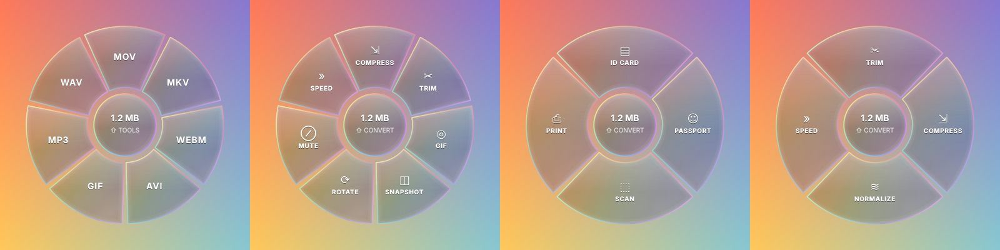

# ShiftWheel

Start dragging any file in File Explorer, press **Shift**, and drop it on a slice of the wheel. Convert it, edit it, or print it — right where you are. Everything happens on your PC; nothing is uploaded.



## How to use

1. Start dragging a file (or several, or a folder) in File Explorer or on the desktop.
2. Press **Shift**. The wheel opens under the cursor.
3. Drop the file on a slice. The result is saved **next to the original**; the original is never changed.
4. Tap **Shift** again to switch rings: **Convert → Tools → Print → File**.


The wheel looks like Santra's by default (warm peach slices, the slice under the cursor lights up orange). Prefer see-through liquid glass? **Settings → Wheel look**.

Also: right-click any file or folder → **ShiftWheel…**, **Send to → ShiftWheel**, or double-click the tray icon. Every action ends with a notification showing what changed, with **Open**, **Show in folder** and **Undo**.

## What it does

| Files | Convert | Tools | Print |
|---|---|---|---|
| **Images** (JPG, PNG, WEBP, HEIC, AVIF, TIFF, BMP, GIF, ICO) | Any of those, or PDF (several images → one PDF) | Compress (to a target size), Resize, Crop, Edit, Annotate, Redact, Add BG, Metadata, **Text (OCR)** | **ID Card**, **Passport**, **Scan**, **Print** |
| **PDF** | JPG/PNG per page, DOCX, TXT | Compress, Split, Rotate, Merge, Protect, Extract images, Metadata, **OCR → searchable** | **Print**, **ID Card**, **Scan** |
| **Video** (MP4, MOV, MKV, WEBM, AVI, WMV…) | MP4, MOV, MKV, WEBM, AVI, GIF, MP3, WAV | Compress (presets or *under N MB*), Trim, GIF, Snapshot, Rotate, Mute, Speed, Merge | |
| **Audio** (MP3, WAV, M4A, OGG, FLAC, OPUS…) | MP3, M4A, WAV, OGG, FLAC, OPUS | Trim, Compress, Normalize loudness, Speed, Merge | |
| **Excel / CSV** (XLSX, XLS, ODS, CSV) | PDF, XLSX, CSV, JSON, HTML | Zip | |
| **PowerPoint** (PPTX, PPT, ODP) | PDF, PNG/JPG per slide | Zip | |
| **Word** (DOCX, DOC, RTF, ODT) · **Text** | PDF, DOCX, TXT | | |
| **Markdown / web pages** (MD, HTML) | PDF, DOCX, HTML / TXT — rendered, not the source code | | |
| **Archives** (ZIP, 7Z, TAR, GZ) | ZIP ⇄ 7Z | Extract | |
| **Folders / anything else** | | Zip, 7Z | |

Every wheel ends with a **File** ring: **Copy path**, **Show** (in its folder), **SHA-256** (checksum to the clipboard) and **Duplicate**.

### The Print ring


- **ID Card** — photocopy-shop layout. Drop a phone photo of the front and back of an ID (Aadhaar, PAN, driving licence, voter ID, bank card, college ID). ShiftWheel finds the card, straightens it, and puts front above back at the **real card size (85.6 × 54 mm)** at the top of one A4 sheet. Drag the corners if the photo is tricky. Colour, grayscale or photocopy B&W; 1–5 copies per sheet; cut lines; other card sizes. **Save PDF** or **Print**.
- **Passport** — 35 × 45 mm (or US 2×2 in, stamp size, visa sizes), 8 copies by default, A4 or 4×6 photo paper, cut lines. Save PDF, JPG for a photo lab, or print.
- **Scan** — straighten a photo of a document into a clean A4 PDF (auto colour clean-up or black & white), with an invisible text layer so you can search and copy the text.
- **Print** — fit, fill or **actual size**, 1/2/4/6/9 per sheet, any paper.

Printing always goes out at **100 % scale**, so a card prints as a card, not blown up to fill the page.

### Video trim


Drag the two handles over the filmstrip (or the waveform, for audio); the preview shows the exact frame. *Precise cut* re-encodes at the exact frame; *Fast* is instant and lossless (cuts at keyframes).

## Install (Windows 10/11)

From the latest build of this repo (**Actions → Build Windows app → ShiftWheel-windows**) or a release:

- **ShiftWheel-Setup.exe** (recommended) — installs for your user only (no admin), adds the Start menu entry, start-with-Windows, the right-click **ShiftWheel…** entry for files and folders, and **Send to**.
- **ShiftWheel.exe** — portable. Turn on **Settings → Show “ShiftWheel…” when you right-click a file** to get the right-click entry without installing (per-user, no admin).

The app isn't code-signed, so SmartScreen may warn on first launch: **More info → Run anyway**.

Office: Excel/PowerPoint/old Word files are exported with Microsoft Office if it's installed (perfect fidelity), otherwise LibreOffice if installed. Spreadsheets and CSV also work with neither.

## Run from source

```bash
pip install -r requirements.txt
python -m shiftwheel
```

## Tests

```bash
python -m pytest -q            # 80+ tests: every engine, every window, every slice of every wheel
python run.py --selftest       # what CI runs inside the built .exe
```

- `tests/test_printing.py` measures the printed card (54 mm) on the generated PDF **and** on Qt's print output.
- `tests/test_wheel_matrix.py` builds the real wheel for a photo, PDF, video, audio, spreadsheet, Word file, archive, folder and a mixed selection, triggers **every slice**, and checks each one produced a file or opened its window.
- **CI (Windows):** unit tests → portable exe + installer → `--selftest` inside both builds (FFmpeg, OCR models, OpenCV, printing, every window) → silent install / run / uninstall.
- **End-to-end (Windows):** `demo/e2e_windows.py` moves the real mouse (on your own PC run it with `--local`: test files go to `%TEMP%` and your Desktop, wallpaper and resolution are left alone): drags files in File Explorer and on the desktop, presses Shift, switches rings, drops on slices, drives the tool windows and checks every output (e.g. it measures the ID card on the saved PDF). Results and a screen recording go to the `e2e-output` branch.

Logs: `%LOCALAPPDATA%\ShiftWheel\log.txt`.

## How the Shift + drag works

A tray app polls the mouse button and Shift key (`GetAsyncKeyState`, no hooks, no admin). When the left button is held, the mouse has moved and Shift goes down, a borderless always-on-top window (the wheel) appears under the cursor and accepts the file drop like any drop target. It always accepts as *copy*, so the original is never moved even though Shift normally means "move" in Explorer.

## Credits & licences

- Built on [DragShift](https://github.com/llamaboi55/DragShift) (MIT) — the wheel, glass rendering, image/PDF tools and test harness. ShiftWheel adds the Print ring (ID card, passport, scan, exact-size printing), video & audio, Excel/PowerPoint/CSV, archives and OCR.
- Inspired by [Santra](https://the reference design) (macOS) and Open-Santra. No code from either.
- Bundled: FFmpeg via imageio-ffmpeg (GPL build), PyMuPDF (AGPL), RapidOCR / PP-OCR models (Apache-2.0), OpenCV (Apache-2.0), Qt for Python (LGPL). If you ever distribute builds publicly, those licences apply to the distributed app (practically: keep the source public).

ShiftWheel's own code: MIT (see LICENSE).
